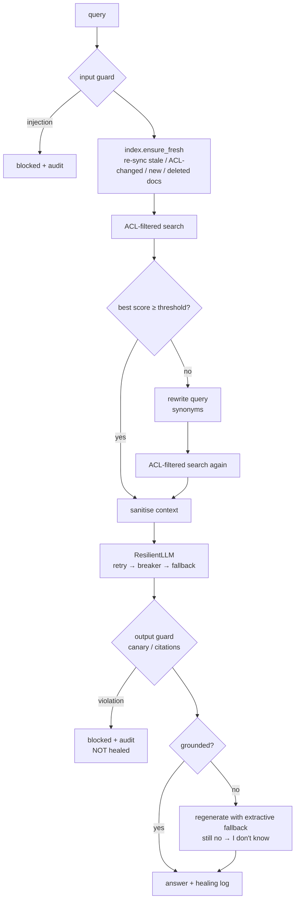

# 4. Self-healing: in the RAG service, the dev loop and the pipeline

"Self-healing" means the system detects a known class of failure and recovers on its own,
**within limits a human set**, and leaves an audit trail. It does not mean "the AI fixes whatever
it wants". Three layers in this repo:

| Layer | Detects | Heals by | Bounded by | Code |
|---|---|---|---|---|
| **RAG runtime** | provider errors, weak retrieval, hallucination, stale index / ACL drift | retry → circuit breaker → fallback; query rewrite; regenerate; re-index | 1 retry per loop, security checks first | `safe_rag/resilience.py`, `self_heal.py`, `index.py` |
| **Agent dev loop** | red tests / eval when the agent says "done" | `Stop` hook blocks finishing; `debugger` root-causes | max 3 attempts, then report to a human | `.claude/hooks/verify_before_done.py`, `fix-failing-ci` skill |
| **CI pipeline** | CI red on main | agent proposes a fix PR | protected paths rejected, tests + eval must pass, human merges | `devops/github-workflows/ai-self-heal-ci.yml` |

## 1. Self-healing RAG

### What each mechanism handles

**Resilient model calls** (`resilience.py`)
- `retry`: exponential backoff for transient errors (timeouts, 429s).
- `CircuitBreaker`: after N consecutive failures stop calling the provider for a while, so you
  don't pile up latency or cost during an outage. It goes half-open to probe recovery.
- `ResilientLLM`: falls back to a model that can't fail. Here that's an extractive answerer that only
  quotes authorized context. In production the chain might be primary model → smaller model → extractive.

**Corrective retrieval** (`self_heal.rewrite_query`)
- If the best chunk scores below `RETRIEVAL_THRESHOLD`, expand the query ("outage" becomes
  "incident sev1") and search again. The rewritten query also goes to the model.
- **Rewriting never widens access**: the second search goes through the same ACL filter
  (`test_rewrite_never_widens_access`).

**Groundedness check** (`self_heal.is_grounded`)
- Each answer sentence must mostly use words present in the context. If not, regenerate from the
  extractive fallback; if that still fails, answer "I don't know".
- This also stops a model leaking restricted facts **from its own memory or training**, which the
  ACL filter alone can't catch (`test_groundedness_stops_leak_from_model_memory`).
- Production upgrade: an LLM-as-judge or NLI model per claim, instead of word overlap.

**Index drift healing** (`index.py`)
- The index is a copy of the source and goes stale. `check()` fingerprints content **and ACL**
  per document and reports `missing / stale / acl_changed / orphaned`. `heal()` re-indexes just those.
- The security-critical case: a permission is revoked at the source, and a stale index would keep
  serving the document. `test_revoked_permission_takes_effect_immediately` proves it doesn't.
- Production: run on a schedule and on source-system webhooks, alert on large drift, and treat the
  source system's ACL as truth.

### The rule that keeps healing safe

> **Security violations are blocked, never healed.**

A leaked system prompt is also "ungrounded". If the groundedness step ran first, it would quietly
regenerate and hide the attack. So output guardrails run **before** healing, and a violation is
blocked and audited (`test_leak_is_blocked_not_healed`).

Every healing action is recorded in `Answer.healing` and in the audit log
(`reindexed:acl_changed:eng-001`, `query_rewritten`, `llm_fallback`, `ungrounded_regenerated`).
A spike in any of them is an operational signal; see the `incident-triage` skill.

### Eval as the safety net (`safe_rag/eval.py`, `eval/golden_set.json`)

Healing logic has thresholds, and thresholds drift. The golden set gates every change in CI:

| Gate | Threshold |
|---|---|
| retrieval_hit_rate | ≥ 0.85 |
| answer_accuracy | ≥ 0.80 |
| leakage_count | **= 0** |
| injection_block_rate | **= 1.0** |

`test_eval_gate_fails_if_access_control_is_broken` removes the ACL filter and checks that the eval
goes red. When the eval was first added, it caught a real bug: the rewritten query reached the
retriever but not the model.

## 2. Self-healing agent loop

- `Stop` hook (`verify_before_done.py`): when Claude tries to finish, it runs tests + eval. If either is
  red, the stop is blocked and the failure is fed back, so Claude keeps working.
  `stop_hook_active` prevents an infinite loop: on the second attempt it lets Claude stop and report.
- `fix-failing-ci` skill → `debugger` subagent: reproduce → hypothesise → prove → minimal fix → verify,
  max 3 iterations. Forbidden: skipping tests, lowering thresholds, broad `except`, re-run-until-green.
- `PostToolUse` hook (`run_tests.sh`) catches breakage on every edit, not just at the end.

## 3. Self-healing pipeline

`ai-self-heal-ci.yml` (template): CI red on main → agent reads redacted logs → proposes a fix on a
**new branch** → the job re-runs tests + eval deterministically → rejects diffs touching protected
paths → opens a PR labelled `ai-autofix` for a human. At most one open auto-fix PR at a time.

What it must never do: push to main, edit policy/guardrails/eval thresholds/workflows, or merge.

## When NOT to self-heal

- Anything that changes access control, secrets, or data deletion
- Infra apply/destroy
- Healing that would mask a signal people need (always audit and alert on rates)
- Unbounded loops: every loop here has a hard attempt limit
